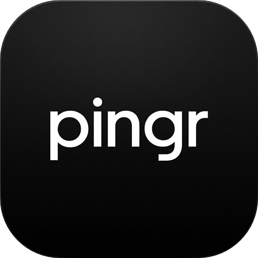

  

<h1 align="center">Pingr</h1>

  A minimal, monochrome Android app that monitors your <strong>AUST IUMS</strong> gradesheet and official <strong>AUST Notices</strong> in the background and notifies you as soon as something new is published.

  
  
  

---

## Features

- **IUMS Gradesheet & AUST Notices**: Switch between **IUMS** and **Notices** (`aust.edu/notice`) via a floating top pill switcher. Notices monitoring works independently without requiring IUMS credentials.
- **Silent Background Monitoring**: Independent monitors for IUMS and Notices run reliably even when the screen is off or the app is closed—no noisy "next check" reminders.
- **Distinct Polling Intervals**: Set separate intervals for **IUMS** and **Notices** in Settings (default `30` minutes, minimum `15` minutes) or use shared quick presets (`15m`, `30m`, `45m`, `60m`).
- **Pull-to-Refresh & Instant Checks**: Pull down on either tab or tap **Check Now** for an immediate update.
- **New-Item Highlighting & Pinning**: Newly published courses and notices are pinned to the top of the list with a highlighted card border and `NEW` badge until you view them.
- **Clean Notifications Without Spoilers**: Grade alerts show the semester name and newly published course code & title—without spoiling your grade. Notice alerts open the full notice directly in your default browser.
- **Semester ID Helper**: Built-in helper in Settings to generate AUST semester codes (`11 + Term + Year`) without guessing.
- **Smart Offline Recovery**: Keeps your last successful check timestamp when offline and automatically fetches the moment internet returns.
- **Smart Session Reuse & Lockout Protection**: Reuses your active IUMS session token until expiry and automatically pauses IUMS monitoring on `401` or `>= 3` failed login attempts to prevent reCAPTCHA lockouts.
- **Monochrome UI**: Clean light and dark grayscale Material 3 interface.

---

## Screenshots

<!-- Add your screenshots to the screenshots/ folder and uncomment/verify the filenames below -->

  
  &nbsp;&nbsp;

---

## Quick Start

1. Download **`Pingr-vX.Y.Z.apk`** from the [**Latest Release**](https://github.com/h3xord/Pingr/releases/latest) page and install it on your Android phone (Android 8.0 or higher).
   - *On Android 17+ or if direct APK installation is blocked? Follow the step-by-step [**ADB / Platform Tools install guide**](MANUAL.md#install-via-adb--platform-tools-android-17-or-blocked-sideloading).*
2. Open **Pingr** and tap the **Settings** gear icon in the top-right corner.
3. *(For IUMS Grades)* Enter your **Student / User ID**, **Password**, and **Semester ID** (tap the **`?`** button next to Semester ID for the built-in helper).
4. Set your preferred **Polling Intervals** for **IUMS** and **Notices** (minimum `15` minutes).
5. Tap **Save** in the top-right corner — you will return to the home screen.
6. *(Recommended)* In Settings, tap **Allow Unrestricted Background** so your phone's battery saver does not delay background checks.
7. Tap **Start Monitor** on the **IUMS** tab, the **Notices** tab, or both (allow notifications when prompted).

For detailed instructions, OEM battery-saver settings (Xiaomi, Samsung, OnePlus, Oppo/Realme), checksum verification, and troubleshooting, read the full [**User Manual (MANUAL.md)**](MANUAL.md).

---

## Security & Privacy

- **Encrypted On-Device Storage**: Your credentials and session token are stored exclusively on your phone using Android `EncryptedSharedPreferences` (`AES256_SIV` keys, `AES256_GCM` values) backed by the Android Keystore.
- **No Cloud Backups**: `android:allowBackup="false"` prevents Android Auto Backup or `adb backup` from exporting your data.
- **HTTPS-Only**: `android:usesCleartextTraffic="false"` ensures all network traffic uses encrypted HTTPS directly to the AUST IUMS portal and `aust.edu`.
- **Zero Analytics or Third-Party Servers**: Pingr has no ads, trackers, telemetry, or external backend servers.
- **Screen-Capture Protection**: Screenshots and recent-app previews are blocked while the Settings screen is open (`FLAG_SECURE`).
- **Verifiable Releases**: Every release includes a `.sha256` checksum so you can verify the APK integrity before installing.

See [SECURITY.md](SECURITY.md) for more details.

---

## Disclaimer

Pingr is an **unofficial**, independent student-built utility and is **not** affiliated with, endorsed by, or maintained by Ahsanullah University of Science and Technology (AUST). Use it responsibly.
