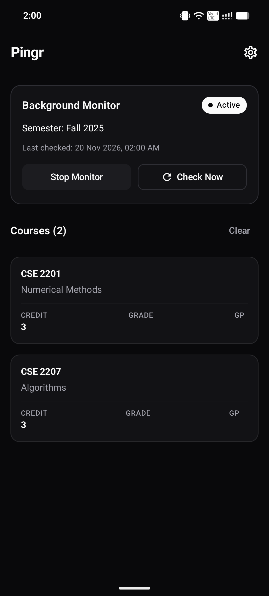

  

<h1 align="center">Pingr</h1>

  A minimal, monochrome Android app that monitors your <strong>AUST IUMS</strong> gradesheet in the background and notifies you as soon as a new course result is published.

  
  
  

---

## Features

- **Silent Background Monitoring**: Checks for new results on a reliable schedule even when the screen is off or the app is closed—no noisy "next check" reminders.
- **Customizable Polling Interval**: Choose your preferred interval in Settings (default `30` minutes, minimum `20` minutes).
- **Clean Notifications Without Spoilers**: Alerts show the semester name and the newly published course code & title—without spoiling your grade in the notification shade.
- **Editable Semester ID**: Switch semesters anytime in Settings without reinstalling.
- **Smart Session Reuse**: Reuses your active IUMS session token until expiry instead of logging in on every check.
- **Lockout Protection**: Automatically pauses background checks if authentication fails or failed login attempts reach `3`, protecting your account from IUMS reCAPTCHA lockouts.
- **Monochrome UI**: Clean light and dark grayscale Material 3 interface.

---

## Screenshots

<!-- Add your screenshots to the screenshots/ folder and uncomment/verify the filenames below -->

  
  &nbsp;&nbsp;

---

## Quick Start

1. Download **`Pingr-vX.Y.Z.apk`** from the [**Latest Release**](https://github.com/h3xord/Pingr/releases/latest) page and install it on your Android phone (Android 8.0 or higher).
2. Open **Pingr** and tap the **Settings** gear icon in the top-right corner.
3. Enter your **Student / User ID**, **Password**, **Semester ID**, and preferred **Polling Interval** (minimum 20 minutes).
4. Tap **Save Settings** — you will return to the home screen.
5. *(Recommended)* In Settings, tap **Allow Unrestricted Background** so your phone's battery saver does not delay background checks.
6. Tap **Start Monitor** (allow notifications when prompted). Pingr will immediately run an initial check and keep monitoring in the background.

For detailed instructions, OEM battery-saver settings (Xiaomi, Samsung, OnePlus, Oppo/Realme), checksum verification, and troubleshooting, read the full [**User Manual (MANUAL.md)**](MANUAL.md).

---

## Security & Privacy

- **Encrypted On-Device Storage**: Your credentials and session token are stored exclusively on your phone using Android `EncryptedSharedPreferences` (`AES256_SIV` keys, `AES256_GCM` values) backed by the Android Keystore.
- **No Cloud Backups**: `android:allowBackup="false"` prevents Android Auto Backup or `adb backup` from exporting your data.
- **HTTPS-Only**: `android:usesCleartextTraffic="false"` ensures all network traffic uses encrypted HTTPS directly to the AUST IUMS portal.
- **Zero Analytics or Third-Party Servers**: Pingr has no ads, trackers, telemetry, or external backend servers.
- **Screen-Capture Protection**: Screenshots and recent-app previews are blocked while the Settings screen is open (`FLAG_SECURE`).
- **Verifiable Releases**: Every release includes a `.sha256` checksum so you can verify the APK integrity before installing.

See [SECURITY.md](SECURITY.md) for more details.

---

## Disclaimer

Pingr is an **unofficial**, independent student-built utility and is **not** affiliated with, endorsed by, or maintained by Ahsanullah University of Science and Technology (AUST). Use it responsibly.
